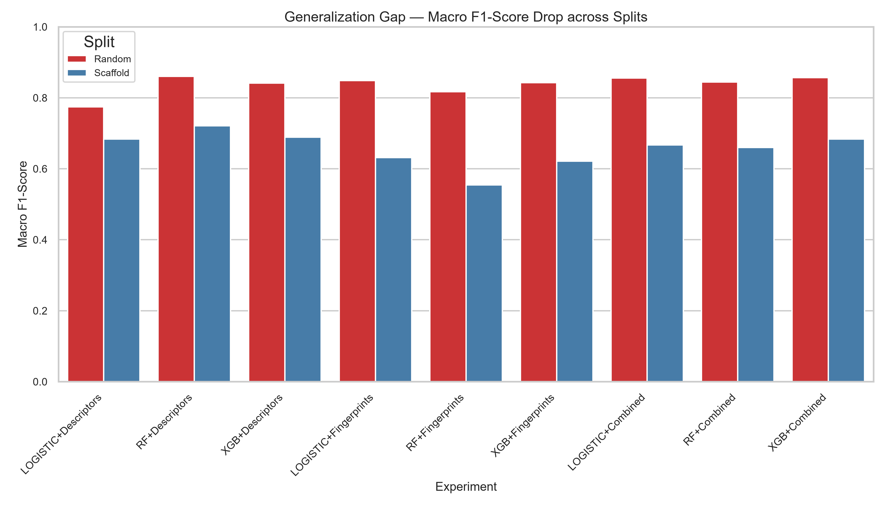

# MoleculeScope

**Predicting whether a drug-like molecule can cross the blood–brain barrier, from its structure alone.**

**Live demo:** [moleculescope.onrender.com](https://moleculescope.onrender.com) — hosted on a free tier, so the
first load after a quiet period can take about a minute while the server wakes up.

MoleculeScope takes a molecule as a SMILES string (or a compound name), computes its physicochemical
descriptors with RDKit, and predicts whether it is likely to reach the brain (BBB+) or not (BBB−). The
model is a Random Forest trained on the public B3DB dataset, served by a FastAPI backend and explored
through a React + TypeScript interface.

The project's main finding is about **evaluation, not just accuracy**: a random train/test split
overstates how well these models work on genuinely new chemistry. Under a scaffold split, where test
molecules have core structures the model has never seen, every model drops sharply — and the model
that drops least is the one we ship.

---

## What it does

- **Predict one molecule** — enter SMILES or search by compound name; see the BBB+ probability, how the
  250 trees voted, where each descriptor sits against the training distribution, and the 2D structure.
- **Explain the prediction** — per-molecule SHAP contributions, plus the model's global feature importances.
- **Check the applicability domain** — the most similar training molecules (Tanimoto similarity), so you
  can tell when a prediction is an extrapolation.
- **Compare candidates** — score up to four molecules side by side.
- **Batch screen** — upload a CSV of SMILES and download the scored results.

---

## Results

Nine models were compared — Logistic Regression, Random Forest and XGBoost, each on three feature sets
(11 descriptors, 2048-bit Morgan fingerprints, and both combined) — under two splits of the same 7,795
molecules (80/20, 6,236 train / 1,559 test).

**Macro F1 on the 11-descriptor feature set**

| Model | Random split | Scaffold split | Drop |
|---|---|---|---|
| **Random Forest** (shipped) | **0.860** | **0.721** | −0.139 |
| XGBoost | 0.842 | 0.689 | −0.153 |
| Logistic Regression | 0.775 | 0.684 | −0.091 |
| Majority-class baseline | 0.389 | 0.379 | — |



**What this shows**

- **Random splits are optimistic.** Similar molecules land on both sides of a random split, so the model
  is partly recognising near-duplicates. The scaffold split removes that shortcut.
- **Fingerprints overfit to structure.** Fingerprint models lose 0.22–0.26 Macro F1 under the scaffold
  split; descriptor models lose 0.09–0.15. Descriptors describe physical properties (size, polarity,
  lipophilicity) that carry over to unseen scaffolds; fingerprints encode the exact substructures.
- **The shipped model** is a Random Forest on the 11 descriptors. On unseen scaffolds it reaches
  **74.5% accuracy, Macro F1 0.721, ROC-AUC 0.802, PR-AUC 0.850**. It was then retrained on all 7,795
  molecules for production; the scaffold figures above are the honest estimate of its performance.

Full tables are in [`results/model_comparison.md`](results/model_comparison.md) and the write-up in
[`docs/RESULTS.md`](docs/RESULTS.md).

---

## Dataset

[B3DB](https://github.com/theochem/B3DB) (Meng et al., *Scientific Data*, 2021) — 7,807 molecules
labelled BBB+ or BBB−.

- **Removed 2** molecules RDKit could not parse.
- **Removed 10** multi-component entries (SMILES containing `.`), which are mixtures rather than single
  molecules.
- **7,795 remain**: 63.5% BBB+, 36.5% BBB−. Because of that imbalance, Macro F1, ROC-AUC and PR-AUC are
  reported alongside accuracy.

The 11 descriptors are molecular weight, LogP, TPSA, H-bond donors, H-bond acceptors, rotatable bonds,
ring count, aromatic ring count, heavy atom count, fraction CSP3 and formal charge.

---

## Tech stack

| Layer | Tools |
|---|---|
| Chemistry and ML | RDKit, scikit-learn, XGBoost, SHAP, pandas, NumPy |
| Backend | FastAPI, Uvicorn, Pydantic |
| Frontend | React 19, TypeScript, Vite |
| Testing | pytest (backend), Vitest + Testing Library (frontend) |

---

## Getting started

Requires **Python 3.13** and **Node.js 22**. Run every command from the repository root.

**1. Backend**

```bash
python -m venv backend/venv
source backend/venv/Scripts/activate   # Windows (Git Bash). PowerShell: backend\venv\Scripts\Activate.ps1
                                       # macOS/Linux: source backend/venv/bin/activate
pip install -r backend/requirements.txt
uvicorn backend.app.main:app --port 8000
```

The API is now at `http://127.0.0.1:8000`, with interactive docs at `http://127.0.0.1:8000/docs`.

**2. Frontend** (in a second terminal)

```bash
cd frontend
npm install
npm run dev
```

Open `http://localhost:5173`.

### API

| Method | Endpoint | Purpose |
|---|---|---|
| GET | `/api/health` | Model status and version |
| POST | `/api/predict` | Predict one SMILES |
| POST | `/api/predict/batch` | Predict many SMILES |
| POST | `/api/explain` | SHAP contributions for one molecule |
| GET | `/api/explain/global` | Global feature importances |
| GET | `/api/molecules/search` | Look up a compound by name |

---

## Tests

```bash
backend/venv/Scripts/pytest backend/tests          # 50 tests
cd frontend && npm test                             # 34 tests
```

---

## Reproducing the model

The trained production model is included at `backend/models/production_model.joblib`, so the app runs
without retraining. To rebuild everything from the raw dataset:

```bash
python backend/src/clean_dataset.py                    # clean B3DB
python backend/src/features/generate_features.py       # descriptors + fingerprints
python backend/src/splitting/split_coordinator.py      # random and scaffold splits
python backend/src/modeling/train.py                   # train all nine models
python backend/src/modeling/evaluate.py                # metrics and figures
python backend/src/modeling/train_production.py        # retrain the chosen model on all data
```

---

## Project structure

```
backend/
  app/            FastAPI app: routes/, services/ (prediction, SHAP, search, applicability domain), schemas/
  src/            Offline pipeline: cleaning, features/, splitting/, modeling/
  models/         Production model and its metadata
  tests/          API tests
frontend/
  src/components/ Predictor, Compare, Batch screener and Performance pages
  src/__tests__/  Component tests
results/          Metrics, figures and per-model predictions for all nine experiments
docs/             Methodology, modelling, evaluation and API notes
Dockerfile        Single container: builds the UI and serves it from FastAPI
```

---

## Limitations

- **Probabilities are not calibrated.** The output is a predicted probability of BBB+, not a confidence score.
- **74.5% accuracy on unseen scaffolds** — useful for early screening and ranking, not for final decisions.
- **Labels are binary.** BBB+/BBB− flattens a continuous property; only 1,058 molecules carry a measured logBB.
- **Applicability domain matters.** Predictions for molecules far from the training set (low Tanimoto
  similarity) should be treated with extra caution, which is why the app shows the nearest neighbours.

More in [`docs/LIMITATIONS.md`](docs/LIMITATIONS.md).
